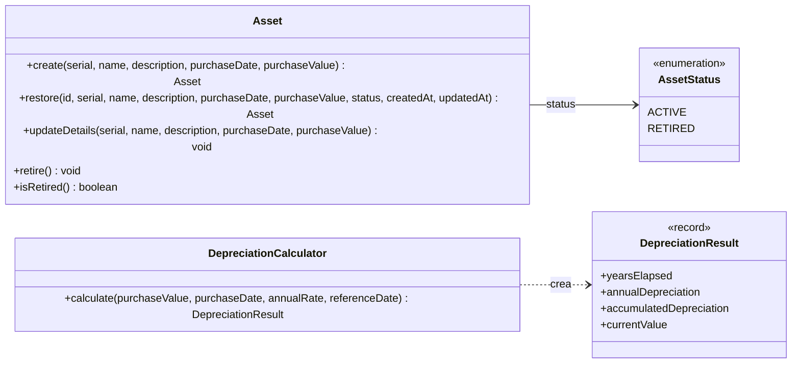
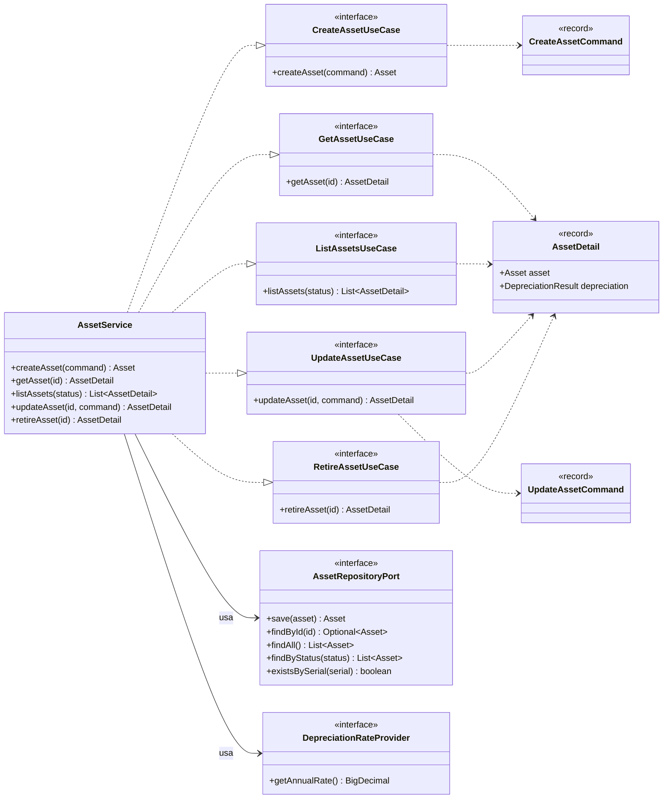

# Diagrama de clases

Vista acotada al **núcleo** del sistema: el modelo de dominio y la capa de aplicación
(puertos y servicio). La infraestructura (controlador REST, mappers, DTOs, entidad JPA) se
describe en el [diagrama de componentes](component-diagram.md).

## Modelo de dominio

## Capa de aplicación

[← Volver al README](../README.md)
