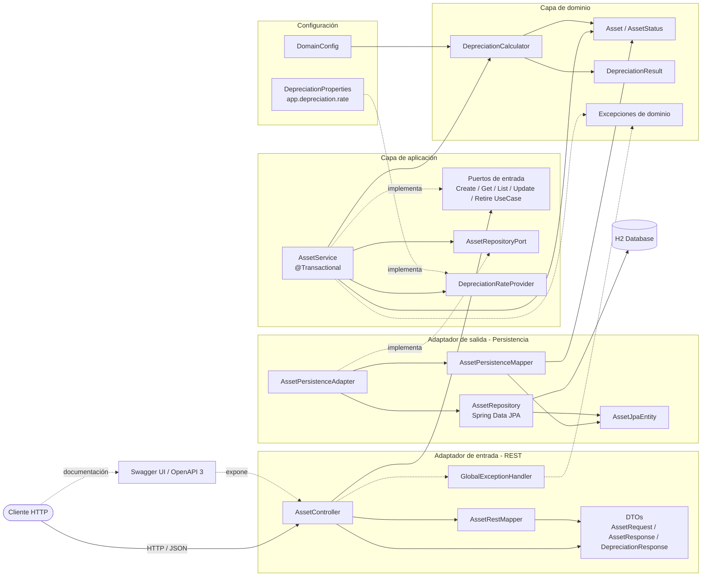

# Diagrama de componentes

Vista por capas de la arquitectura hexagonal: el cliente entra por el adaptador REST, la
aplicación orquesta los casos de uso a través de puertos, el dominio contiene las reglas de
negocio y la persistencia se resuelve con un adaptador JPA hacia H2.

**Regla de dependencia:** las flechas de infraestructura apuntan hacia las interfaces
(puertos) de la aplicación, y el dominio no depende de ninguna capa externa. Esto permite
sustituir H2, la fuente de la tasa de depreciación o el adaptador REST sin tocar las reglas
de negocio.

[← Volver al README](../README.md)
