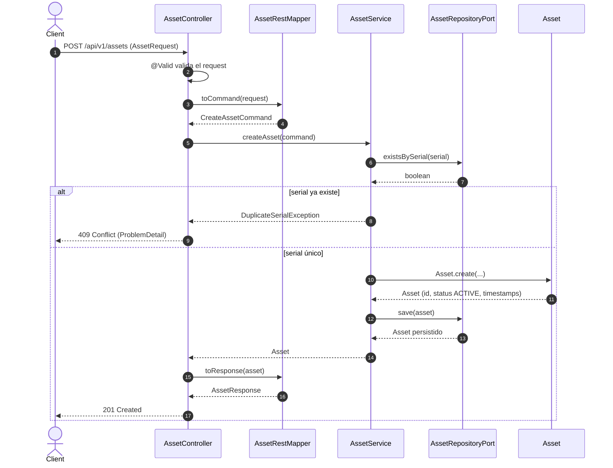
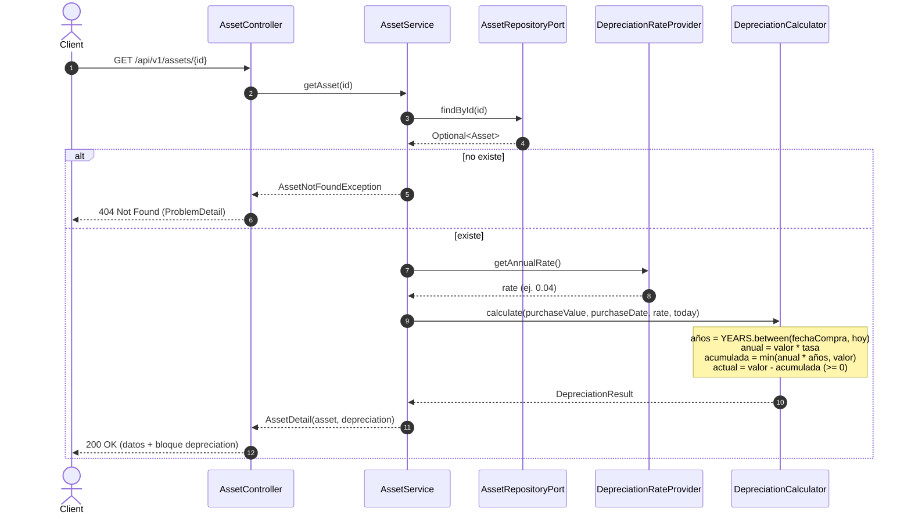
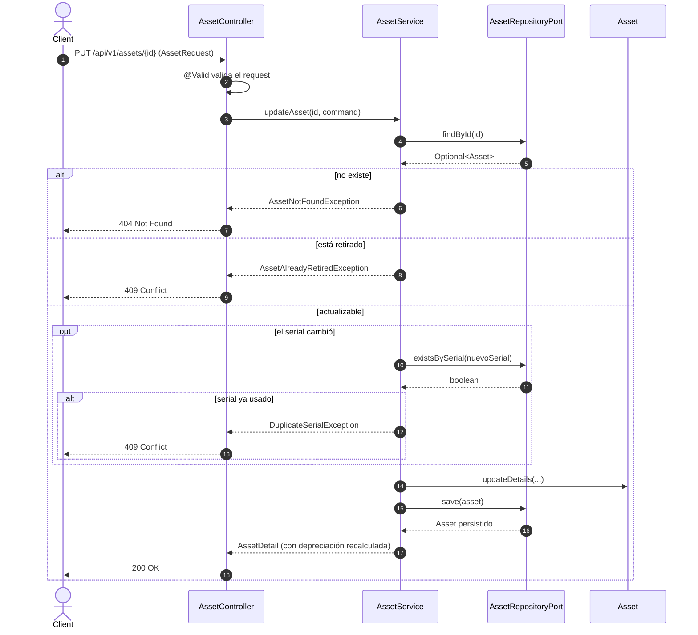
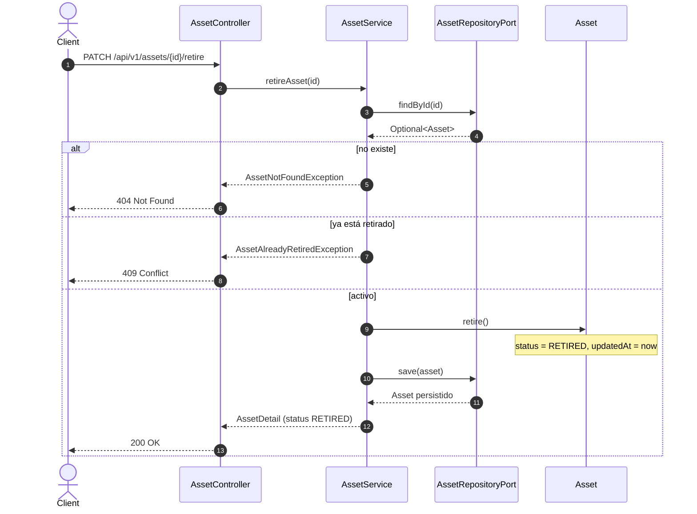

# Diagramas de secuencia

Flujos principales del servicio REST.

## 1. Registrar equipo — `POST /api/v1/assets`

## 2. Consultar equipo por id (con depreciación) — `GET /api/v1/assets/{id}`

## 3. Actualizar equipo — `PUT /api/v1/assets/{id}`

## 4. Dar de baja lógica — `PATCH /api/v1/assets/{id}/retire`

[← Volver al README](../README.md)
